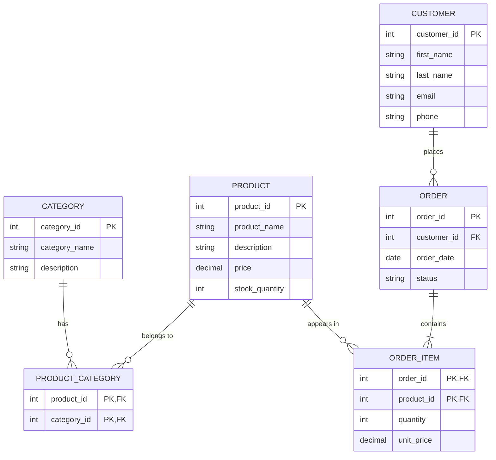

# Exercise 1 – TrailShop ER Diagram

## ER Diagram

### Design decision

In Week 37, `products.category_id` allowed one product to belong to only one category. This is not enough because one product can belong to more than one category. `ProductCategory` is used as a junction entity to resolve the Category–Product M:N relationship. `OrderItem` is also important because it stores the quantity and the price of a product in a specific order.

**Note:** `ProductCategory` is the junction entity. `OrderItem` is treated as a weak/dependent entity in this assignment.
